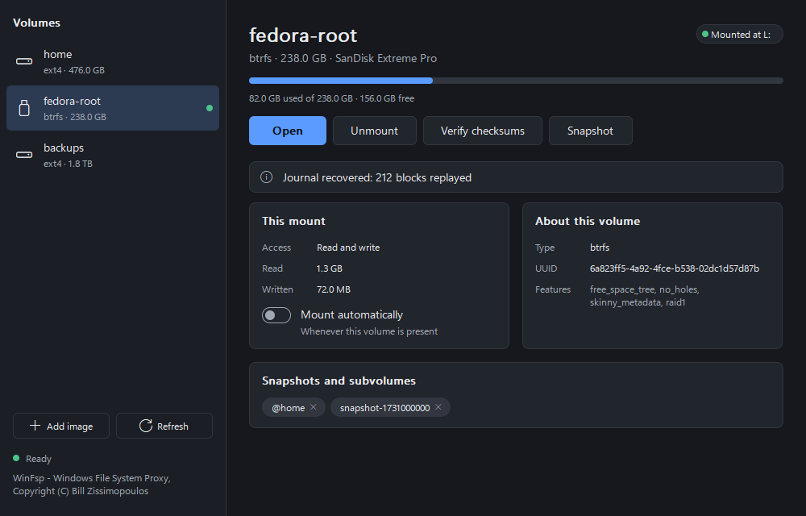

# NixMount

Mount ext2, ext3, ext4 and Btrfs volumes on Windows, LUKS-encrypted ones included, with drive
letters, in one small program.

NixMount is a Rust reimplementation of two long-running projects, [Ext4Fsd] and [WinBtrfs],
combined into a single application. Both are kernel drivers written in C. NixMount does the
same job in memory-safe user-mode code, so a bug or a corrupted disk can fail one request but
can't crash Windows.

| | Ext4Fsd + WinBtrfs | NixMount |
|---|---|---|
| Install | Separate installers per project | One 4 MB file, nothing else to download |
| Runs as | Two kernel drivers | One program, using the Microsoft-signed [WinFsp] driver it carries |
| Bad data on disk | Can crash the machine | An error on that request |
| ext4 writes | Not journaled | Journaled through the real jbd2 log |
| Mounting read-only | May replay the journal to disk | Never writes: recovery happens in memory |
| Encrypted (LUKS) volumes | Not supported | Unlocked with their passphrase |
| Secure Boot | Workarounds or a paid signature | Nothing to sign |
| Source | About 220,000 lines of C and C++, with bundled libraries | About 15,000 lines of Rust |
| Memory | Kernel pool | 5 MB for the interface, 2 MB for the idle service |

## Getting started

1. Download `NixMount-Setup.exe` from [Releases](../../releases) and run it.
2. Select **Install**. This is the only setup step: the driver is included.
3. Pick a volume and select **Mount**.

Volumes mount read-only until you turn on **Allow writing**. To look through a volume or copy
files out without installing anything, use **Browse files**.

Windows may warn about an unrecognized app the first time, because the file isn't code-signed.
Select **More info**, then **Run anyway**.

## How far to trust it

This is a young project, and a filesystem is the last place to take that lightly. Its engines
are tested hard (see [Verification](docs/design.md#verification)), but they have not yet had
years of daily use. Keep backups of anything you write to, and try it on an image or a spare
disk first.

## Documentation

- [User guide](docs/guide.md): mounting, writing, snapshots, the command line, troubleshooting
- [Compatibility](docs/compatibility.md): which filesystem features work, and what changed from the originals
- [Design](docs/design.md): how it works and how it is verified
- [Security](docs/security.md): the threat model and what the design does about it

## Contributors

Built by NitroDiesel and Claude. See [CONTRIBUTORS](CONTRIBUTORS.md).

## License

GPL-2.0-only. See [NOTICE](NOTICE) for how this relates to the original projects.

WinFsp - Windows File System Proxy, Copyright (C) Bill Zissimopoulos,
<https://github.com/winfsp/winfsp>

[Ext4Fsd]: https://github.com/bobranten/Ext4Fsd
[WinBtrfs]: https://github.com/maharmstone/btrfs
[WinFsp]: https://winfsp.dev/rel/
